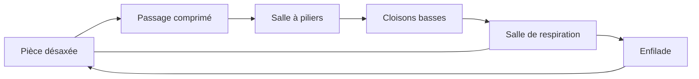

# Level 0 — direction visuelle mixte, compositions avant monde infini

Dossier de préparation, 9 octobre 2026, révisé après la précision de l'utilisateur : **la cible visuelle associe les Backrooms de Kane Pixels, les bonnes références classiques précédentes et les images choisies par l’utilisateur**. Ce document décrit le travail futur ; il ne certifie aucune de ces fonctions comme implémentée. Le lot présent est une remise à zéro du prototype. Voir la [bibliothèque de références](../level0-references/README.md), les [repères et sources](../level0-references/REPERES_PHOTOGRAPHIQUES.md) et le [manifeste](../level0-references/manifest.json). Les vues de chantier, de circuits RC et d'entrepôts ne constituent plus des cibles de direction artistique.

Le nouvel objectif est de découvrir des lieux que l'on aurait envie de photographier et de continuer à explorer. Le jaune, le papier peint et une grille de néons ne suffisent pas : la qualité viendra de proportions choisies, de chemins qui se dévoilent et de contrastes d'échelle. L'immensité doit apparaître au cours d'un trajet, au milieu de nombreux espaces simples. Des plans jaunes continus, un premier plan qui masque la profondeur, une lumière fluorescente diffuse et des volumes intentionnels définissent désormais la cible de composition. Le résultat ne doit pas évoquer un chantier abandonné, une réserve commerciale cassée ou un entrepôt industriel.

## 1. Ce qui est fixé maintenant

Le prototype de référence reste vide : Level 0 classique, papier peint jaune, moquette, plafond suspendu, éclairage fluorescent dynamique. Aucun mobilier, objet ramassable, entité, carte, inventaire, besoin de survie ou progression persistante. Marche et sprint PC, regard libre, pause. Une nouvelle graine entière non signée de 32 bits est tirée avec `crypto.getRandomValues` au lancement et à chaque nouvelle exploration explicite.

Une pause ou une reprise conserve la même exploration. Une graine aléatoire ne garantit pas mathématiquement de ne jamais répéter une ancienne graine ; elle garantit un nouveau tirage. La reproductibilité de développement dépend du couple `(version du générateur, graine)`, jamais de la graine seule.

Le baseline technique est une grille de cellules de 2,5 m, des chunks de 16 cellules connectés et un plafond de 2,8 m. On le conserve comme témoin de fluidité et de stabilité. Les prochaines propositions ne sont pas à ajouter à ce générateur par une succession de tirages indépendants.

La vision historique de survie et de multiples niveaux reste une archive de projet. Elle n'impose aucune interface ou fonction à ce laboratoire d'exploration. Le beau bureau en bois est conservé à part ; il ne revient pas discrètement dans le Level 0 vide.

## 2. Références et statut des idées

**Bibliothèque mixte :** les publications officielles de Kane Pixels servent d’appui pour les compositions et changements d’échelle ; les bonnes photographies classiques précédentes, dont HT-DSC00159/160/161, gardent leur place ; les images fournies par l’utilisateur fixent aussi la cible de matière et de lumière. Aucun auteur ne monopolise la direction. Le Wikidot reste une source de lore distincte. Les captures des films de Kane Pixels sont des images d'une œuvre, pas des photographies d'architecture réelle. Les photographies de travaux, de circuits et d'entrepôts du premier corpus sont hors cible, même lorsqu'elles exposent une trame constructive intéressante.

L'utilisateur demande une direction visuelle, pas le remplacement du canon de gameplay par celui de Kane Pixels. Les organisations, événements, personnages, technologies et règles narratives de ses films ne sont pas importés avec leur style architectural. Les textures, modèles et plans du jeu restent originaux. Aucun filtre VHS, HUD de caméra, secousse artificielle du regard ou entité n'est réintroduit pour imiter la présentation des films.

Les catégories restent distinctes dans le corpus : « appuyé par le wiki » ne veut pas dire « montré par Kane Pixels » ; une capture de film ne prouve pas une dimension réelle ; un bâtiment industriel photographié ne devient pas une référence du Level 0 par sa seule vacuité.

| Motif | Appui dans le corpus préparé | Utilisation proposée |
|---|---|---|
| Cloison qui cache le prolongement, angles désaxés | Photos HT-DSC00161 et HT-DSC00160 | Vocabulaire central, fréquent |
| Série d'arches et cloison partielle | Photos HT-DSC00159 et HT-DSC00160 | Variation classique, sol et plafond continus |
| Demi-mur et ouverture laissant voir sans laisser passer | Noyau historique HT-DSC00159 ; cible de cadrage à confronter aux publications officielles de Kane Pixels | Sol continu, accès décalé ; pas de palier de chantier comme modèle à reproduire |
| Salle à piliers et répétition qui déforme la perception des distances | Composition d'auteur à régler à partir du corpus Kane Pixels vérifié | Rare, structurée et vide entre les supports ; aucun semis de poteaux d'entrepôt |
| Plafond bas, plans proches, lumière diffuse, profondeur masquée | Direction Kane Pixels demandée ; images officielles sélectionnées dans la bibliothèque | Traits centraux pour les six compositions ; matières jaunes continues et cadrages oppressants |
| Puits noirs en grappe ou en grille | Texte Wikidot actuel et plans officiels de Pitfalls KP-PIT-0245 / KP-PIT-0330 (4:05 et 5:30, images de film) | Motif appuyé par le texte ; pas une preuve photographique historique. Prototype séparé après décision sur le vide |
| Hauteur vertigineuse, hall monumental | Recherche de contraste d'échelle orientée Kane Pixels, à valider image par image | Proposition rare à tester ; pas une propriété universelle du Level 0 ni un prétexte pour importer un atrium vitré |
| Architecture qui se transforme hors champ | Texte du wiki | Différé : incompatible avec l'objectif initial de monde stable et de reproduction des bugs |

Les IDs ci-dessus renvoient au manifeste, qui conserve les publications sources et les informations de provenance vérifiées. Sources officielles de départ : [The Backrooms (Found Footage), Kane Pixels](https://www.youtube.com/watch?v=H4dGpz6cnHo) et [Backrooms — Found Footage #2, Kane Pixels](https://www.youtube.com/watch?v=sA5PxGHqpTo). La bibliothèque détaille les images retenues ; ce dossier n'invente aucun minutage ni ne prétend que chaque motif apparaît dans chacun des films. Sources complémentaires : [corpus photographique HobbyTown](https://archive.org/details/backrooms-photos), retenu pour ses vues classiques cohérentes, dont HT-DSC00159/160/161, et [Level 0 — Threshold, Wikidot](https://backrooms-wiki.wikidot.com/level-0), révision du 6 octobre 2026 consultée par la recherche. Les références servent à l'étude, sans être transformées automatiquement en textures ou assets distribués.

**Règle de direction :** varier la forme et la lumière à l'intérieur de la même famille jaune. Pas de Poolrooms, béton industriel, Cloudrooms, néons colorés ou salons domestiques dans ce premier générateur. Des arches ou des piliers ne nécessitent pas de changer de biome.

### Traduction concrète du style souhaité

La pièce pilote doit tenir par sa géométrie et sa lumière. Depuis une hauteur d'œil humaine, un plan proche occupe une partie du cadre ; derrière, une continuation laisse supposer davantage d'espace qu'on n'en voit. Les sorties ne sont pas toutes offertes au même regard. Les murs forment de grands aplats cohérents, avec un détail de papier peint discret à distance. Le plafond module les proportions et la lumière, au lieu de devenir un réseau de poutres décoratives.

Le jaune se travaille en valeurs : lumière chaude diffuse, zones moins éclairées gardant leur volume, quelques surfaces émissives vraiment intenses. Ni bain jaune uniforme, ni noir total généralisé, ni bloom qui efface chaque angle. La répétition apporte une échelle, puis un déplacement ou une omission très localisée crée l'incertitude. La compression et l'ouverture se répondent ; la monumentalité arrive après des espaces ordinaires, avec une transition construite.

Pour chaque composition, la revue compare une vue d'entrée, une vue de révélation et une vue intérieure avec les images officielles retenues. Une ressemblance de palette ne suffit pas. Les proportions, la quantité de vide, l'ordre des plans et la manière dont la lumière révèle la profondeur doivent porter la même intention. Les tailles proposées plus bas restent des paramètres de prototype, jamais des mesures déduites des films.

## 3. L'unité de génération est une composition

Une composition est un petit morceau d'architecture pensé depuis plusieurs points de vue : volume, obstacles, ouvertures, directions de lumière et raccords. Elle décrit une intention, pas un simple rectangle avec un numéro de type.

Chaque fiche contient : une empreinte, une hauteur, ses passages, un parcours principal, les points où le lieu se révèle, une zone de silence visuel, les supports structurels, la grille du plafond et ses exceptions, puis les variantes autorisées. Un tirage peut modifier des distances, retourner un agencement ou enlever un pilier secondaire. Il ne peut pas supprimer la cloison qui fait fonctionner le cadrage.

### Première tranche jouable : six compositions seulement

Toutes les dimensions suivantes sont **des valeurs de conception à tester**, pas des mesures tirées du wiki ou des films. Les plages sont des cibles de proportions ; les valeurs produites seront arrondies dans la plage au quantum géométrique retenu, sans réduire la largeur libre minimale.

| ID | Composition | Dimensions de départ | Moment recherché | Invariant à protéger |
|---|---|---|---|---|
| C01 | Pièce désaxée | 8–13 × 9–16 m ; hauteur 2,8 m | Une cloison proche masque une seconde profondeur ; le prochain passage se révèle après quelques pas | Deux sorties non alignées ; aucun axe donnant toute la pièce à voir depuis l'entrée |
| C02 | Couloir comprimé | largeur 0,95–1,15 m ; longueur 5–10 m ; hauteur 2,35–2,8 m | Passage inconfortablement étroit, puis ouverture sur C01 ou C04 | Largeur libre continue ; aucun besoin d'accroupissement ou de saut |
| C03 | Enfilade d'ouvertures | 12–20 m ; passages de 2–3 m ; hauteur 2,8 m | Répétition de cadres, disparition d'une issue derrière une cloison | Trois cadrages au maximum dans la tranche ; éviter le couloir de portes identiques à l'infini |
| C04 | Salle à piliers et masses jaunes | 16–24 × 18–30 m ; hauteur 2,8–3,2 m ; piliers rectangulaires de 0,6–1,8 m, à régler sur les plans retenus | Un espace très ouvert devient un labyrinthe optique quand on change d'axe | Piliers réellement séparés des murs ; parcours de 1,1 m minimum ; aucune forêt de colonnes sans vide |
| C05 | Cloisons basses | 10–16 × 12–20 m ; demi-murs hauts de 1–1,2 m | Voir un lieu sans pouvoir y aller en ligne droite ; hésitation calme | Passage latéral visible, pas de labyrinthe de mobilier ; couvre-mur continu et sans faces superposées |
| C06 | Salle de respiration | 12–18 × 14–22 m ; hauteur 2,8 m | Presque rien, une sortie décalée et une zone légèrement moins éclairée | Au moins 60 % de l'empreinte sans obstacle ; pas de point d'intérêt artificiel au centre |

L'expression « six compositions » désigne six familles architecturales, pas six salles ajoutées partout en même temps. Une première promenade finie peut parcourir C01 → C02 → C04 → C05 → C06 → C03 avec une boucle de retour C03 → C01. Elle permet d'évaluer les relations entre les lieux avant de demander au hasard de les arranger.

Le trait supplémentaire A–E représente une liaison facultative, utile pour éviter qu'un seul long circuit devienne immédiatement évident. Ce graphe est un outil de conception ; il n'apparaît pas comme carte dans le jeu.

### Composer les révélations

Un espace impressionnant arrive derrière un contraste : passage serré → vaste salle, champ proche bouché → profonde grille de piliers, plafond bas → grand volume. La grande salle n'est pas toujours annoncée par son axe central. Une entrée tangente en révèle d'abord la largeur, puis la profondeur. Un demi-mur peut laisser apercevoir une deuxième sortie sans transformer la pièce en poste de bureau.

Une salle silencieuse n'est pas un échec de génération. Le vide rend une anomalie ultérieure sensible. On rejette le réflexe de mettre un pilier, une arche, un trou et une cloison dans chaque pièce pour la « rendre intéressante ».

## 4. Rythme, rareté et connectivité

Les fréquences sont des hypothèses de design. On les mesurera par distance parcourable et par surface, en plus du nombre de salles : compter seulement les salles ferait dominer un immense hall malgré un faible poids de tirage.

| Famille future | Budget initial de surface praticable | Restriction de rythme |
|---|---:|---|
| Architecture classique simple : C01, C03, C06 et raccords | 65–75 % | Il doit exister des séquences ordinaires de 30–60 m |
| Compression et cloisons basses : C02, C05 | 15–25 % | Pas deux très longs passages comprimés consécutifs |
| Grande grille de piliers : C04 | 8–15 % | Pas de deux salles de même signature directement voisines |
| Monumentalité et puits, lorsqu'ils seront prêts | 0 % dans la première tranche ; plafond expérimental ultérieur 3 % | Jamais dans le spawn, ni imposés toutes les quelques minutes |

Les bandes ne doivent pas être additionnées librement : le profil choisit des valeurs précises totalisant 100 %. Un premier profil peut être 70/20/10/0. Une pénurie de candidats ne doit pas pousser le système à surproduire la rareté ; le repli est une pièce classique simple.

À chaque nouvelle exploration, le départ offre un rayon sûr d'au moins 3 m, une hauteur normale, un passage clairement lisible et aucune collision initiale. Dans les 60–120 premiers mètres de parcours possible, le graphe garantit une compression, une révélation et une alternative de chemin. Il ne garantit pas un hall gigantesque. La connexion au spawn et aux interfaces du secteur est vérifiée avant tout habillage.

Les culs-de-sac sont de petites poches facultatives, pas une succession de murs après vingt minutes de marche. Hypothèse initiale : au moins une boucle par ensemble de 6–10 compositions, un cul-de-sac optionnel pour quatre compositions au maximum, longueur de branche terminale normalement inférieure à 20 m. Ces valeurs sont ajustées après parcours réel, pas sanctuarisées avant test.

## 5. Représentation spatiale et frontières

### Sortir de la grosse cellule sans perdre le déterminisme

Le moteur doit manipuler des mètres. La cellule de 2,5 m peut survivre comme index d'accélération ; elle ne décide plus de toutes les largeurs. On propose un quantum horizontal de 0,125 m et un quantum d'altitude de 0,025 m : les coordonnées architecturales sont stockées en entiers, puis converties en mètres pour le rendu. Le premier permet des passages fins et est compatible avec le module de plafond de 0,625 m ; le second conserve exactement le plafond initial de 2,8 m. Les positions physiques du joueur restent continues. Les sections murales sont des segments à épaisseur explicite ; les piliers sont des empreintes distinctes, pas des cellules pleines maquillées.

Les outils de génération produisent d'abord une description intermédiaire : `Space`, `WallSegment`, `Column`, `FloorRegion`, `CeilingRegion`, `Opening`, `Fixture`, `Connection`. Rendu, collision et éclairage lisent cette même description. Aucun passage visible ne peut avoir sa collision définie par un autre tirage aléatoire.

Un volume porte ses altitudes de sol et plafond. Une ouverture porte largeur, hauteur libre et altitude. Une région de sol peut être absente ; ce n'est pas une texture noire. La première tranche impose néanmoins `floorY = 0` partout : multiplier immédiatement étages, escaliers et puits rendrait les défauts impossibles à isoler.

### Trois niveaux séparés

1. **Plan logique** : sélectionne les compositions, leurs interfaces et le graphe praticable.
2. **Géométrie validée** : résout dimensions, raccords, collisions et surfaces.
3. **Décor architectural et rendu** : plafond, panneaux, matières, lumière et détails sobres.

Un décor ne corrige jamais une mauvaise connectivité. La fonction de génération doit pouvoir tourner sans WebGL pour produire un rapport et des empreintes reproductibles. Les piliers sont des éléments de composition : leur silhouette et leur rythme sont revus avec la sélection visuelle mixte avant adoption. Leurs dimensions ci-dessus servent seulement au premier essai. Ni poteaux métalliques de chantier ni blocs épais semés partout ne satisfont cette intention par défaut.

### Qui décide au bord d'un chunk ?

Une frontière possède une clé canonique `(axe, coordonnée fixe, intervalle, version, seed)` et un contrat partagé : positions exactes des ouvertures, largeur, hauteur, niveau du sol, surfaces et phase de plafond. Les deux voisins calculent ce même contrat sans dépendre de l'ordre de chargement. Une composition peut s'étendre sur plusieurs chunks de rendu ; elle a un propriétaire logique unique et ses fragments sont découpés pour le streaming. Le chunk n'est pas une salle.

Une grille logique de macro-secteurs, par exemple 32 m pour l'expérience initiale, sert à indexer et réserver les empreintes. Cette taille reste à confirmer après les six compositions. Le choix des grandes réservations se calcule dans un voisinage borné avec priorité stable par hash ; le résultat ne doit pas dépendre de la première composition demandée. Prévoir une marge suffisante pour les motifs qui franchissent la frontière. Les candidats en conflit sont départagés avant de générer l'intérieur ; le repli remplit les zones non réservées avec du classique. La recherche de raccords doit avoir un nombre maximal d'essais puis un repli valide, sans propagation récursive sans borne entre secteurs. Tant que cette règle de propriété n'est pas testée, on garde la tranche finie ; on n'improvise pas un monde infini avec des raccords ajoutés après coup.

Les murs partagés sont émis une seule fois ou découpés avec une responsabilité de face explicite. Les joints en T et les marches de plafond possèdent des détails géométriques définis, sans languette coplanaire de camouflage. Les arêtes de matériaux et la grille du plafond utilisent une origine mondiale stable.

### Canaux de hasard

Chaque décision reçoit son propre domaine : `layout`, `template`, `dimensions`, `connections`, `ceiling`, `fixtures`, `wear`. Utiliser un hash entier spécifié de `(seed, version, domaine, identifiant spatial)`. Éviter un PRNG global dont le prochain résultat change quand on ajoute un détail de papier peint. Les coordonnées négatives utilisent un vrai floor et une division définie ; la numérotation d'une arête est identique dans les deux sens. Ne pas utiliser `Math.random()` au sein du générateur.

Le monde est stable pendant une exploration. Décharger/recharger un secteur, changer de direction ou faire une pause ne le transforme pas. Le lore d'espaces mouvants reviendra seulement avec une proposition et des tests propres, pas comme effet secondaire d'un cache.

## 6. Verticalité, lumière et vides : lots distincts

### Plafond et néons

Les diffuseurs remplacent des dalles ; ils ne flottent pas sous elles. La grille de 0,625 m possède une phase par composition compatible avec ses interfaces. Les retours de cadre, le vide de dalle et la surface émissive sont construits ensemble. Une différence de hauteur reçoit une retombée fermée, sans rayon de ciel visible. Les pièces à hauteur normale restent majoritaires.

Le moteur actuel a des hypothèses à 2,8 m dans l'irradiance verticale, les corniches et certaines approximations d'ombre. La position réelle des sources, la hauteur locale du plafond et les volumes d'occlusion doivent remplacer ces constantes **avant** de juger un hall haut. Un néon à 12 m n'éclaire pas comme le même panneau à 2,8 m. Il faudra choisir puissance, densité et rebond selon l'image recherchée, sans rendre toute la salle uniformément lumineuse.

Les demi-murs demandent une occlusion dépendant de la hauteur : un masque 2D de mur plein produit des ombres fausses. Commencer par les limites connues, puis comparer côté éclairé/côté masqué, haut/bas de mur et contacts de piliers. Tout clignotement reste synchronisé entre panneau, lumière directe, rebond approximatif et bloom. Un faible bloom n'excuse pas une mauvaise lumière.

### Monumentalité, après la tranche classique

Premier essai contrôlé : un seul hall de 24–36 m de large, de 30–50 m de profondeur, hauteur 7–12 m, relié par un passage normal. Ces valeurs sont une proposition artistique. Il faut le voir depuis deux entrées et depuis le milieu, puis vérifier qu'il ne ressemble ni à un entrepôt ni à une église. Répétition de panneaux et colonnes continue à donner l'échelle humaine ; aucune multiplication aléatoire de moulures ou poutres.

Le rayon actuel de rendu ne suffit peut-être pas à lire ce volume. Prévoir visibilité par espaces/portails, conservation du fond d'une grande salle et, si nécessaire, géométrie lointaine simplifiée. Un brouillard uniforme qui efface le fond n'est pas une validation de monumentalité.

### Trous sans fond

Ils restent absents de la première tranche. Leur future fiche doit répondre à trois questions avant activation : le joueur peut-il tomber, quel est le résultat de la chute, et comment cela s'accorde-t-il avec le prototype sans survie ni sauvegarde ? On ne décide pas silencieusement d'une permadeath dans un laboratoire visuel.

Pour une première étude visuelle réversible : un puits isolé ou une petite série dans une salle dédiée, avec rebord architectural/chemin de contournement réellement visible. Les zones de vide sont retirées du maillage du sol et possèdent une classification physique. Le trajet principal reste praticable ; le spawn et les interfaces ne sont jamais sur le vide. Pas de mur invisible au bord d'un trou apparemment franchissable : si les chutes ne sont pas encore conçues, un garde-corps ou un demi-mur doit rendre l'interdiction concrète.

« Sans fond » est un effet de perception, pas une géométrie infinie. Une paroi profonde fermée hors portée, une extinction lumineuse progressive et l'absence de repère terminal peuvent le produire. Il faut inspecter le puits depuis tous les bords : aucune tranche de sol flottante, face arrière manquante ou disparition brutale. Une future physique de chute exigera un lot séparé, avec arrêt/reprise et sortie d'expérience explicites.

## 7. Streaming et fluidité : aucune dette cachée dans la caméra

Le générateur ne doit pas transformer un passage de secteur en image bloquée. L'ancienne reconstruction globale au changement de chunk est un risque à mesurer, surtout pour une grille de plafond et un champ lumineux plus riches. Le regard reste direct, sans interpolation retardée destinée à masquer une charge CPU.

Les chunks de géométrie sont préparés devant le joueur et conservés brièvement derrière lui. Les résultats validés arrivent par morceaux ; le maillage visible n'est remplacé qu'une fois son voisin prêt. Priorité : sol et collisions, surfaces opaques, puis lumière/détails. Un Worker peut produire plans et tableaux de sommets ; l'upload WebGL reste sur le thread principal. Définir un budget de travail par image et étaler les uploads. Si le Worker n'est pas retenu au début, le générateur incrémental doit respecter le même budget.

Le rayon de préchargement dépend du sprint de 3,8 m/s et des temps mesurés de génération : le chargement doit finir avant que le joueur atteigne la frontière, avec marge. Pas de plancher absent pendant l'attente. Les coordonnées de rendu restent proches d'une origine flottante ; l'identité des espaces, le hash, les UV et la phase des néons restent mondiaux.

**Budgets indicatifs, à calibrer sur le PC réel :** médiane d'image sous 16,7 ms à la résolution interne retenue ; p95 sous 22 ms, p99 sous 33 ms sur une marche de cinq minutes ; aucune pause de génération supérieure à 50 ms après préchauffage ; travail de génération/upload sur thread principal visé sous 2 ms par image. Consigner résolution, GPU/navigateur, HDR, bloom, cadence et nombre de triangles/draw calls. Ce ne sont pas des résultats déjà obtenus ni une promesse universelle de 60 FPS.

Mesurer séparément génération logique, validation, maillage, champ lumineux, upload et rendu. Une moyenne à 60 FPS peut cacher un saut toutes les deux secondes. Ne pas élargir le monde ou ajouter la verticalité tant que le streaming des six compositions ne passe pas ce contrôle.

## 8. Validation reproductible, sans carte en jeu

Le harnais de développement accepte une graine fixée et une version. L'interface joueur continue à tirer une graine neuve. L'identifiant seed/version peut être lu dans le diagnostic de développement pour reproduire un signalement ; aucun plan ni minimap n'est réintroduit. Une route de QA est une suite de positions et d'angles dans les fichiers d'essai, pas un objet porté par le joueur.

Le fichier `corpus-graines.json` est un **jeu d'entrées proposé**, pas un ensemble de mondes déjà évalués. Il inclut zéro, la borne uint32, des motifs binaires, la graine historique et plusieurs valeurs ordinaires. Aux tests se joignent les secteurs négatifs et lointains. Une graine n'est dite « belle » qu'après parcours et captures ; on ne sélectionne pas une seed de démonstration pour masquer les autres. Pour le contrôle des fréquences, une fois le monde continu disponible, échantillonner au moins 10 000 m² praticables par graine du corpus : cible de surface agrégée à ±5 points du profil choisi, et signalement séparé de tout écart par graine supérieur à 10 points. Les petites tranches finies ne peuvent pas servir à cette mesure statistique.

| Critère | Mesure/essai | Condition de passage |
|---|---|---|
| Déterminisme | Même seed/version, ordres de demande normal/inversé/aléatoire, déchargement/rechargement | Empreintes canoniques identiques pour plan, collision et maillage ; ordre des sommets normalisé si nécessaire |
| Frontières | Tous les voisins de secteurs du corpus, y compris x/z négatifs | Contrats symétriques, mêmes altitudes et ouvertures, aucune face doublée ni fuite |
| Connexion | Graphe puis flood fill des surfaces praticables avec le rayon réel du joueur | Spawn, sorties obligatoires et boucles atteignables ; aucun passage visuel bouché physiquement |
| Échelle | Marche et sprint dans C02 ; contact piliers et demi-murs | Largeur minimale tenue, glissement stable, aucune accroche ou traversée à 30/60/144 Hz et après image lente |
| Plafond | Vue rasante/verticale, raccords et panneaux | Aucune dalle derrière un diffuseur, aucun z-fighting, grille alignée et retombées fermées |
| Lumière | Panneau stable puis clignotant ; quatre vues d'une même composition | Source et éclairage concordent ; aucune fuite à travers mur ; limites d'approximation documentées |
| Rythme | Mesures de surfaces et routes pour toutes les seeds du corpus | Profil 70/20/10/0 respecté à tolérance documentée sur une région assez grande, séquence initiale garantie |
| Composition | Captures standardisées + promenade réelle | Six familles lisibles sans différence de matériau ; au moins deux vues convaincantes par famille |
| Fluidité | Parcours cinq minutes avec franchissements à répétition | Budgets mesurés tenus sur configuration de référence ; aucun rattrapage du regard |
| Périmètre | Inspection UI et données chargées | Aucun modèle, objet, inventaire, carte, entité ou système de survie réintroduit |

### Procédure visuelle

Pour chaque famille, fixer trois caméras : avant la révélation, pendant, au centre. Conserver FOV, hauteur d'œil, résolution et exposition identiques. Comparer aux images fournies par l’utilisateur, aux plans officiels Kane Pixels retenus et aux bonnes références classiques : ordre des plans, compression, profondeur, valeurs lumineuses et quantité de vide. La dominante jaune ne suffit pas. Écarter les comparaisons flatteuses avec les chantiers et entrepôts du premier corpus. Parcourir ensuite en mouvement : une capture peut cacher une sortie absurde ou une immense face vide.

Le premier passage couvre six compositions × trois caméras. Le deuxième examine six graines distinctes avec un trajet de 60–120 m chacune. Le troisième lance les tests invariants sur le corpus complet, puis des tirages supplémentaires enregistrés. Les captures servent à revoir la composition ; un test de triangles valide la géométrie, pas la beauté.

### Cas à rejeter immédiatement

Une salle qui assemble tous les motifs ; une rangée de piliers qui barre une sortie ; un couloir de 0,7 m considéré « ouvert » par le graphe ; une énorme pièce coupée par le rayon de rendu ; un plafond haut avec lumière artificiellement collée à 2,8 m ; un trou noir peint sur une dalle ; un passage entre deux hauteurs ouvert sur le ciel ; un joint de plafond qui change à chaque chunk ; des arches toutes identiques visibles sur cent mètres ; une vue jolie uniquement depuis le spawn ; une seed qui transforme presque tout en hall monumental ; un menu de survie resté accessible par raccourci ; un plateau de chantier simplement recoloré en jaune ; des piles d'accessoires ou du béton brut importés pour donner une fausse impression de détail ; un filtre VHS utilisé pour cacher les défauts ; un ajout du lore Kane Pixels présenté comme règle Wikidot.

## 9. Ordre de travail et livrables

| Lot | Travail borné | Livrable vérifiable | Sortie attendue |
|---|---|---|---|
| 0 — présent | Clean slate, source historique conservée, graine fraîche, QA caméra/connexion | Prototype vide publié et état de référence | Enlever les systèmes demandés sans perdre la fluidité |
| 1 — revue de direction | Parcourir la sélection mixte : films Kane Pixels, photos classiques cohérentes et images choisies par l’utilisateur, choisir les cadrages, relever les désaccords | Six fiches de composition avec images sources identifiées et objectifs de lumière | Définir ce que « grandiose » veut dire ici avant d'élargir le code |
| 2 — une bonne pièce | C01 en mètres, segments de murs, plafond/panneaux/collision issus des mêmes données | Une pièce finie à trois vues + mesures | Prouver la nouvelle représentation et la qualité d'un lieu |
| 3 — tranche finie | Les six familles connectées, graine figée de QA, une boucle | Promenade de 5–8 minutes avec captures et liste des défauts | Juger composition, rythme et lumière avant l'infini |
| 4 — invariants | Contrats de frontières, canaux seed, propriété et validation | Rapports déterministes, essais négatifs, empreintes | Plus aucun choix dépendant de l'ordre de chargement |
| 5 — continuité | Assemblage de macro-secteurs, streaming incrémental, préchargement | Plusieurs seeds parcourables, traces de performance | Une base infinie stable à partir du vocabulaire approuvé |
| 6 — monumentalité | Une composition haute dans un environnement contrôlé, lumière 3D adaptée | Comparatif normal/haut et profil coût | Valider l'échelle et sa rareté avant diffusion |
| 7 — vides | Décision physique explicite puis prototype séparé de puits | Test des bords, du contournement et du résultat d'une chute si activée | Ajouter un motif inquiétant sans système de mort improvisé |
| 8 — édition des poids | Profils et transitions revus sur nombreuses seeds | Corpus annoté, distributions, régressions visuelles | La constance doit survivre à un tirage quelconque |

Chaque lot commence petit, corrige ses défauts, puis passe au suivant. Les nombres de seeds, les dimensions et les budgets proposés pourront évoluer sur la base des captures et des mesures. Ajouter d'autres niveaux, meubles, survie ou entités ne fait partie d'aucun de ces lots.

**Point d'arrêt actuel :** terminer le clean slate et remettre le corpus et ce dossier à l'utilisateur. Le nouveau générateur ne démarre pas en arrière-plan dans ce lot. La prochaine étape est la revue des références et des six compositions, puis une pièce pilote vérifiable ; l'organisation demandée précède l'implémentation spectaculaire.
